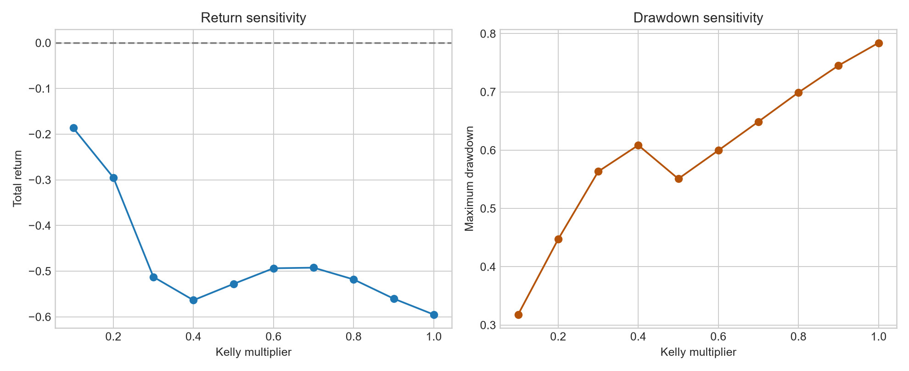

# The Longshots Were Overpriced. The Trade Still Lost Money.

*What 84,767 resolved Kalshi and Polymarket contracts reveal about calibration, favorite-longshot bias, and the distance between a statistical pattern and a tradable edge.*

**Suggested Substack excerpt:** Prediction markets were meaningfully better than a naive forecast, but they were not perfectly calibrated. Longshots were overpriced, favorites were underpriced, and a clean out-of-sample Kelly strategy still lost money.

---

Prediction markets make a seductive promise: compress thousands of opinions, incentives, and fragments of information into one number that looks like a probability.

A YES contract trading at 30 cents seems to say, simply, “30%.” But does a basket of those contracts actually resolve YES 30% of the time? And if it does not, can a trader turn the difference into profit?

I tested those questions on **84,767 resolved binary contracts** from Kalshi and Polymarket, using the market price approximately 48 hours before the event as the forecast. The sample contains 22,762 Kalshi contracts and 62,005 Polymarket contracts, with entries spanning March 2023 through September 2026.

The result is a useful warning for anyone doing systematic research:

> A market can show a real, statistically significant bias without offering a stable trading edge.

The prices were informative. They beat a naive base-rate forecast by a wide margin. They also displayed a clear favorite-longshot pattern: low-probability outcomes were generally overpriced, while several high-probability groups were underpriced. Yet a purged, out-of-sample strategy built to exploit that pattern lost money.

That is not a disappointing result. It is the result that makes the project interesting.

## First question: were the markets calibrated?

Calibration asks whether quoted probabilities match empirical frequencies.

If a market is perfectly calibrated, contracts priced near 70% should resolve YES about 70% of the time. I grouped contracts into 10-percentage-point price bands and compared each band’s mean market price with its observed resolution rate.

The curve follows the diagonal closely enough to show that market prices contain substantial information, but the deviations are systematic rather than random.

The overall **Brier score was 0.1565**, compared with **0.2213** for a forecast that always predicts the sample’s 33.1% YES rate. Because lower is better, the market improves on that naive benchmark by 0.0648 Brier points, or about 29%.

Kalshi recorded the lower Brier score:

| Venue | Contracts | Market Brier | Naive Brier |
|---|---:|---:|---:|
| Kalshi | 22,762 | 0.1390 | 0.2202 |
| Polymarket | 62,005 | 0.1630 | 0.2217 |
| Combined | 84,767 | 0.1565 | 0.2213 |

This does not prove that Kalshi is universally “better.” The venues contain different mixtures of categories, contract designs, participant bases, and time periods. It does show that, in this sample, both venues beat their own unconditional base-rate forecasts.

## The favorite-longshot pattern is visible

For each probability bin, I defined bias as:

**mean market price − observed YES frequency**

A positive number means contracts were overpriced. A negative number means they resolved YES more often than their prices implied.

The lowest-priced contracts show classic longshot overpricing:

| Price band | Contracts | Mean price | YES frequency | Bias |
|---|---:|---:|---:|---:|
| 0–10% | 20,570 | 2.84% | 1.98% | +0.86 pp |
| 10–20% | 6,399 | 15.27% | 12.94% | +2.33 pp |
| 20–30% | 9,079 | 25.12% | 19.13% | +5.99 pp |

All three differences are statistically significant in a one-sample t-test. The 20–30% band is especially striking: a contract priced around 25% resolved YES only about 19% of the time.

The pattern reverses among stronger favorites:

| Price band | Contracts | Mean price | YES frequency | Bias |
|---|---:|---:|---:|---:|
| 70–80% | 2,211 | 75.31% | 79.78% | −4.48 pp |
| 80–90% | 2,008 | 86.06% | 91.73% | −5.68 pp |
| 90–100% | 2,639 | 96.95% | 97.69% | −0.74 pp |

This is the familiar favorite-longshot shape. Traders appear willing to pay too much for a small chance at a large payoff, while very likely outcomes can trade a little too cheaply.

## The two venues do not have the same shape

Both venues overprice the lowest-probability contracts by a similar absolute amount: roughly 0.94 percentage points on Kalshi and 0.83 points on Polymarket in the 0–10% band.

The upper end is where the samples diverge. In the 80–90% band, Kalshi prices were 10.5 percentage points below the observed YES rate, while the comparable Polymarket bias was close to zero and statistically insignificant.

That difference is descriptive, not automatically causal. It could reflect category mix, liquidity, contract design, correlated markets, or the text-based classifier used to assign Polymarket categories. A stronger follow-up would compare matched market types or run a contract-level regression with venue, category, time, and liquidity controls.

## Then I tried to trade it

Finding a pattern in the full sample is easy to overstate. A tradable test must only use information that would have been available at the time.

I therefore used a **purged chronological split**:

- The first test entry occurs on November 26, 2025.
- The training set contains 58,949 contracts whose outcomes were already known before that point.
- The test set contains 25,468 later contracts.
- Each test contract receives a model probability from its training-period calibration bin.
- Positions are sized with quarter Kelly and constrained by available cash.
- I compare idealized fills with a second simulation that pays half of a fixed 2-cent spread on entry.

This setup is deliberately simple. It asks whether the historical calibration curve, by itself, persists strongly enough to trade.

It did not.

| Scenario | Final bankroll | Total return | Sharpe | Max drawdown | Trades |
|---|---:|---:|---:|---:|---:|
| No transaction costs | $5,384 | −46.2% | −0.34 | 60.7% | 6,069 |
| 2-cent spread | $6,114 | −38.9% | −1.11 | 47.4% | 5,135 |

The cost-adjusted version loses less money, but that is not because costs help. The spread removes many marginal signals, so the strategy trades less. Its risk-adjusted performance remains poor.

Reducing position size helps, but does not rescue the strategy. At one-tenth Kelly—the least aggressive setting tested with the 2-cent spread—the strategy still loses 18.7%, and every Kelly multiplier from 0.1 to 1.0 finishes below the starting bankroll.

## Why a significant bias can still be unprofitable

There are several reasons the full-sample result does not translate cleanly into P&L.

First, **statistical significance is not economic significance**. With more than 84,000 observations, even a small average pricing error can be estimated precisely. A 0.86-point bias in the lowest bin is real in the sample, but may still be too small, unstable, or inaccessible after execution frictions.

Second, **the effect is not stationary**. A calibration curve estimated across years and venues can hide changes in participant behavior, market composition, or information quality. The held-out period does not have to repeat the training average.

Third, **contracts are not independent**. Prediction markets frequently contain clusters of related questions. Thousands of rows can reflect fewer underlying events, which makes naive confidence intervals look more decisive than event-clustered uncertainty would.

Fourth, **binning throws away information**. Every contract in a 10-point band receives the same historical model probability. That is transparent and easy to audit, but too coarse to distinguish a stale 21% market from a liquid 29% market driven by new information.

Finally, **execution is more complicated than a fixed spread**. Real strategies face depth limits, fees, partial fills, changing spreads, and the possibility that the displayed historical price was not available at meaningful size.

## What I would do next

The next version of this project should focus less on adding complexity to the Kelly formula and more on improving validation and signal quality.

I would:

1. Group related contracts by event and use event-clustered confidence intervals.
2. Replace the single split with rolling, purged walk-forward validation.
3. Compare matched venue/category cohorts rather than raw venue averages.
4. Add liquidity, volume, spread, and price-staleness features.
5. Fit a regularized calibration model and compare it with the simple bin estimator.
6. Test whether the bias is concentrated in particular market types or regimes.
7. Simulate order-book capacity rather than assuming every signal can be filled.

## The real takeaway

Prediction markets in this sample were useful forecasters. Their prices substantially outperformed an unconditional base rate, and the calibration curve revealed a recognizable favorite-longshot bias.

But “the market is biased” and “I can profit from the bias” are different claims.

The first claim received strong descriptive support. The second failed a basic out-of-sample test.

That gap is exactly where good quantitative research begins: not with the discovery of a pattern, but with the attempt to make it survive time, costs, sizing, and skepticism.

---

*Method note: The analysis uses resolved binary contracts, prices observed approximately 48 hours before the event, 10-percentage-point calibration bins, one-sample t-tests on price-minus-outcome errors, and a cash-constrained fractional-Kelly backtest. Polymarket categories are inferred from market text. All code, tables, figures, and caveats are included in the accompanying repository.*

