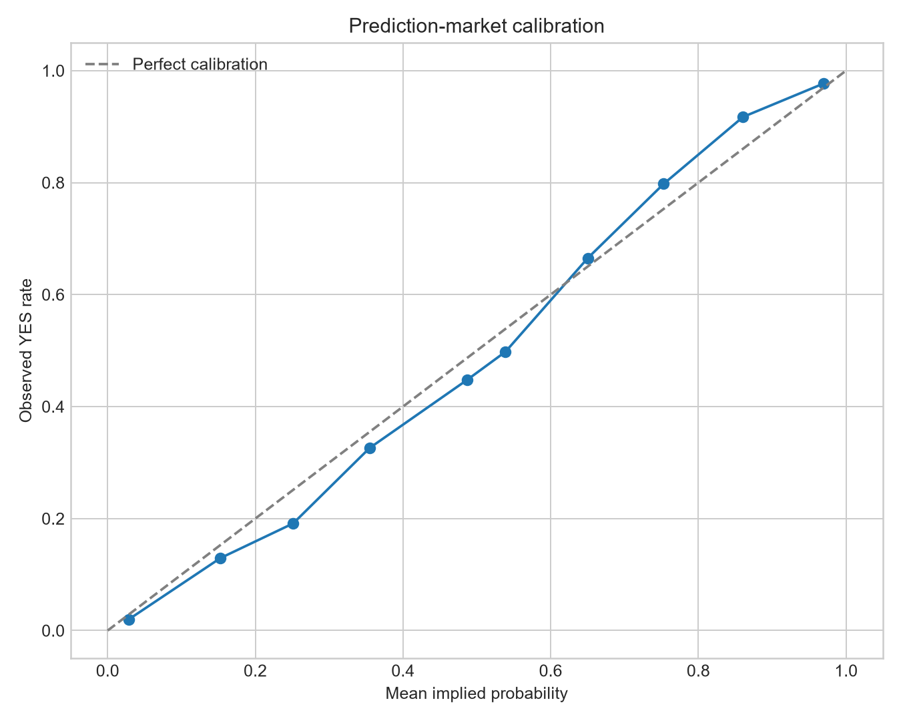
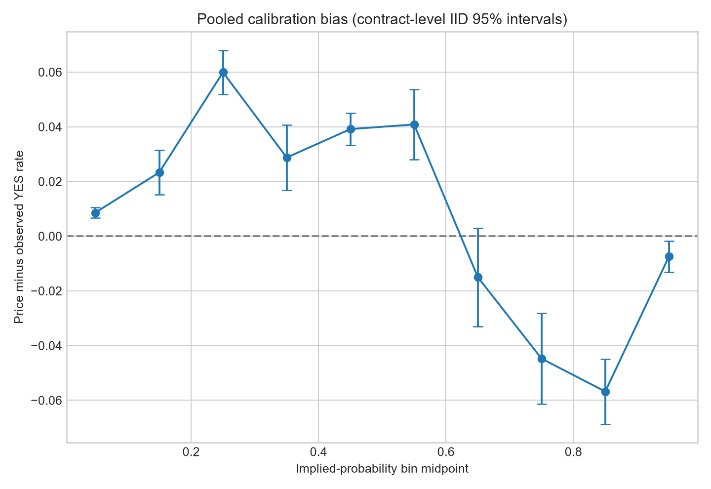
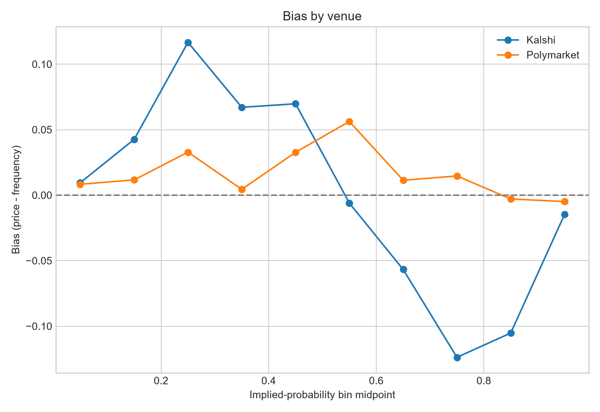
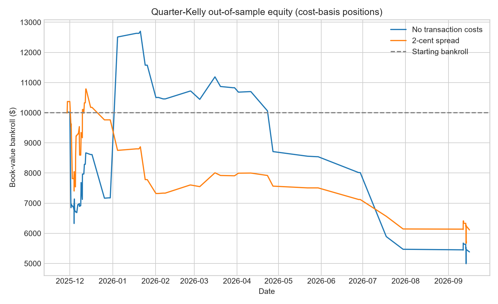

# Prediction Markets Were Informative, Imperfectly Calibrated, and Still Hard to Trade

*What 84,767 historical Kalshi and Polymarket contracts say about calibration, favorite–longshot-style patterns, and the difference between a statistical signal and an executable edge.*

**Suggested excerpt:** In this historical sample, prediction-market prices beat a naive base-rate forecast but were not perfectly calibrated. The pooled data show a favorite–longshot-style asymmetry, yet a simple out-of-sample fractional-Kelly strategy lost money under stylized execution assumptions.

---

Prediction markets turn a question into a number that looks like a probability. A YES contract at 30 cents appears to say that an event has roughly a 30% chance of occurring. That makes two questions unavoidable: are those numbers useful forecasts, and does any calibration error translate into a trade?

I studied 84,767 resolved binary contracts from Kalshi and Polymarket: 22,762 Kalshi contracts and 62,005 Polymarket contracts. The saved observation for each contract is anchored approximately 48 hours before the **scheduled** event or end time. It is not a uniform 48-hour-before-resolution sample: actual settlement or closure can occur earlier or later than scheduled time.

The result is more interesting than a simple “markets are efficient” or “markets are biased” story.

> In this historical sample, pooled prediction-market prices exhibit calibration asymmetries consistent with favorite–longshot bias under contract-level IID inference. The effect varies materially by venue and price range, and a simple out-of-sample calibration strategy does not produce positive returns under the modeled assumptions.

## First: the probabilities contained useful information

The overall market Brier score was **0.1565**, versus **0.2213** for a forecast that always used the sample’s 33.1% YES rate. Lower is better, so the market probabilities substantially improved on that simple constant benchmark.

| Venue | Contracts | Market Brier | Own base-rate Brier |
|---|---:|---:|---:|
| Kalshi | 22,762 | 0.1390 | 0.2202 |
| Polymarket | 62,005 | 0.1630 | 0.2217 |
| Combined | 84,767 | 0.1565 | 0.2213 |

This is a statement about this sample, not proof that either venue is universally better. The venues differ in market mix, contract design, time period, and participants.

## Then: calibration was not perfect

Calibration asks whether contracts assigned a given probability resolve at that frequency. I divided prices into ten percentage-point bands and defined bias as **mean market price − observed YES frequency**. Positive bias means the market price exceeded the realized YES rate; negative bias means it fell below that rate.

| Price band | Contracts | Mean price | YES frequency | Bias |
|---|---:|---:|---:|---:|
| 0–10% | 20,570 | 2.84% | 1.98% | +0.86 pp |
| 10–20% | 6,399 | 15.27% | 12.94% | +2.33 pp |
| 20–30% | 9,079 | 25.12% | 19.13% | +5.99 pp |
| 60–70% | 2,635 | 65.03% | 66.53% | −1.50 pp |
| 70–80% | 2,211 | 75.31% | 79.78% | −4.48 pp |
| 80–90% | 2,008 | 86.06% | 91.73% | −5.68 pp |

The 20–30% result is large in the pooled sample: contracts priced around 25% resolved YES about 19% of the time. The 80–90% result points in the opposite direction. This is consistent with a favorite–longshot-style calibration asymmetry, but the shape is not perfectly monotonic: the pooled 60–70% bin is not statistically significant under the project’s contract-level IID test.

## Venue differences are part of the result

The two venues should not be described as having the same pattern. The 20–30% overpricing appears on both, but it is much larger on Kalshi. At the upper end, the pooled 80–90% favorite effect is substantially stronger on Kalshi; the comparable Polymarket estimate is near zero and not statistically significant.

Those differences are descriptive, not causal. They could reflect category mix, contract design, liquidity, correlated questions, or measurement choices. They do not identify a venue-level behavioral mechanism.

## Forecast quality also varied by category

The pooled result also hides meaningful category heterogeneity. Lower Brier scores
indicate more accurate probability forecasts in this sample, but the differences
should not be read as evidence that any category is inherently more efficient.

| Category | Contracts | Market Brier |
|---|---:|---:|
| Science/Technology | 656 | 0.0412 |
| Economics/Finance | 4,593 | 0.0661 |
| Politics | 3,198 | 0.1061 |
| Crypto | 22,576 | 0.1775 |
| Sports | 41,027 | 0.1803 |

These differences could reflect sample size, venue composition, contract
construction, liquidity, or time period rather than a stable category-level
property. Economics/Finance is an interesting future research direction: its
low Brier score raises the question of whether a category-specific calibration
model could outperform the pooled model, but an Economics/Finance-only trading
strategy has not been tested here.

Better predictive accuracy does not necessarily mean a better trading
opportunity. A category can be easier to predict because market prices already
incorporate information well. A profitable strategy requires a persistent gap
between market price and true probability that survives out of sample and after
execution costs.

## A historical calibration curve did not become trading alpha

A pattern in a full historical sample is not yet a trading strategy. To impose a basic time boundary, I used a purged chronological split:

- 58,949 contracts whose outcomes resolved before the first test entry form the training set.
- 25,468 later contracts form the test set.
- Each test contract receives the historical outcome rate of its training-period price bin.
- Positions use a cash-constrained quarter-Kelly rule.
- I compare a zero-cost assumption with a fixed 2-cent total entry-spread sensitivity.

The simulation counts a trade only if its scaled stake is at least one cent; positive mathematical edges before cash and stake filters are reported separately in the repository outputs.

| Scenario | Final bankroll | Total return | Book-value Sharpe | Book-value max drawdown | Executed trades |
|---|---:|---:|---:|---:|---:|
| No transaction-cost assumption | $5,383 | −46.2% | −0.34 | 60.7% | 5,272 |
| Fixed 2-cent entry spread | $6,113 | −38.9% | −1.11 | 47.4% | 4,546 |

The fixed-spread run lost less money, but costs did not help. The spread removes marginal signals and changes the set of simulated positions. Every fixed-spread Kelly multiplier from 0.1 through 1.0 ended below the starting bankroll.

That negative result is informative. It shows that the simple calibration-bin signal was not robust enough to create positive returns in the held-out period under these assumptions. Statistical significance is not the same thing as a large, stable, or tradable edge.

## Why the caution matters

The analysis has meaningful limits:

- The timing convention is based on scheduled event/end metadata. Actual resolution timing varies, and historical metadata may have changed.
- The historical sample can involve post-close metadata filters. This is a retrospective sample-selection limitation, not evidence that test outcomes directly entered the chronological calibration model.
- Kalshi and Polymarket price fields are not guaranteed to be the same microstructure object. They should not be treated as verified historical executable bid/ask quotes.
- Liquidity, depth, volume, fill probability, fees, slippage, queue position, capacity, and historical executable quotes are not fully modeled.
- The 2-cent spread is a fixed stylized sensitivity, not a reconstruction of historical contract-level transaction costs.
- The reported confidence intervals and p-values treat contracts as independent. Related events and markets can be correlated, so IID uncertainty may be too narrow. Venue, category, and bin comparisons are exploratory and are not adjusted for multiple testing.
- Categories are not generated identically across venues; Polymarket labels can rely on text heuristics.
- Open positions are held at cash plus locked capital, or cost basis, rather than fully marked to market. Sharpe and drawdown are book-value metrics.
- This is a selected historical sample, not demonstrated coverage of all prediction markets ever listed.

## The takeaway

Prediction-market probabilities in this sample were useful forecasts. They were also not perfectly calibrated, and the pooled evidence contains a favorite–longshot-style asymmetry with substantial venue heterogeneity.

But observed calibration bias is not necessarily executable trading alpha. A simple, transparent out-of-sample Kelly implementation lost money even before a full model of realistic execution frictions.

That is the useful result: good quantitative research does not stop after finding a pattern. It asks whether the pattern survives time, dependence, selection, sizing, and execution.

---

*Method note: the canonical package analysis uses the committed clean CSV, ten-percentage-point bins, contract-level IID t-tests on price-minus-outcome errors, and a purged chronological split. The accompanying repository can rebuild the analysis from the committed clean dataset, but not perfectly reconstruct the original historical API acquisition from a fresh clone.*
